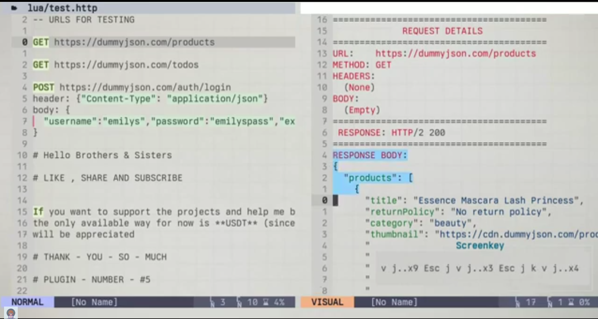

# rest-client.nvim

[](https://opensource.org/licenses/MIT)
[](https://github.com/sponsors/janecodelife)

A lightweight, minimal, and fast HTTP requests (GET, POST, PUT, DELETE, etc.) REST client for Neovim 0.12+ built entirely on top of Neovim's native networking APIs . support all kind of files . so run it anywhere , everywhere in a blink

---

## ✨ Features

- ⚡ **Run it directly from under the cursor** hover about url and run the keymap <leader>hr.
- 🔄 **Asynchronous Execution:** Your UI will never freeze or lock while waiting for an API response.
- 🎛️ **Smart Multiline Block Parsing:** Place your cursor anywhere inside an HTTP instruction block, and the plugin will dynamically find the correct method, headers, and payload.
- 🎨 **Smart Auto-formatting:** Automatically formats and pretty-prints JSON responses in a vertical split window.

---

## 📦 Prerequisites

```bash
curl

```

---

## 📥 Installation & Configuration

```lua
vim.pack.add({
	"https://github.com/janecodelife/rest-client.nvim",
})

require("rest-client").setup({
	keymap = "<leader>hr", -- Specify your preferred keyboard shortcutto run the request when you above url
})

```

---

## How To Use

Create a test file (e.g., `test.http` or `api.rest` or `test.txt` or `test.php` or `test.lua` or even `whatever.whatever :D`) and format your endpoints sequentially. Put your cursor anywhere inside or directly below the block you want to test and press your configured keymap (default: `<leader>hr`).

### Example File Layout:

```http

GET https://dummyjson.com/products
GET https://dummyjson.com/todos

POST https://dummyjson.com/auth/login
header: {"Content-Type": "application/json"}
body: {
  "username":"emilys","password":"emilyspass","expiresInMins":100
}

```

---

## 📦 Installation & Setup

---

## Video 📺

<!-- <p align="center"> -->
<!--   <a href="https://www.youtube.com/watch?v=jBUKpSBhoxI" target="_blank"> -->
<!--      -->
<!--   </a> -->
<!-- </p> -->

[](https://www.youtube.com/watch?v=jBUKpSBhoxI)

---

## 💝🤟 Support the Project 🤟💝

<p align="center">
  <a href="https://github.com/sponsors/janecodelife">
    
  </a>
</p>

Every bit of support fuels the expansion of this ecosystem and helps me write cleaner tools for all of us. Thank you for standing behind independent developers!_ 🙏🤟

---

## 💝🤟 A huge thank you to our sponsors! 💝🤟

<!-- SPONSORS -->
<!-- SPONSORS -->

---

## 🔗 My Other Plugins

Check out my other open-source tools to supercharge your Neovim environment:

- **[livewire-secure-properties](https://github.com/janecodelife/livewire-secure-properties)** - Secure livewire app properties by default and void headache.
- **[todo-tracker.nvim](https://github.com/janecodelife/todo-tracker.nvim)** - Assign and list app todos in a blink
- **[folders-bookmark.nvim](https://github.com/janecodelife/folders-bookmark.nvim)** - Bookmark folders and accessing them by keymap in a blink
- **[copy-history.nvim](https://github.com/janecodelife/copy-history.nvim)** - Access your copy (Yank) history and paste it again with support of edit by 1 click in a blink.
- **[rest-client.nvim](https://github.com/janecodelife/rest-client.nvim)** - run http request from anywhere in a blink
- **[smart-window-focus.nvim](https://github.com/janecodelife/smart-window-focus.nvim)** - resize split window on focus to be full size to easy to see and debug.

---

## If Have A Question 🤝 (Contact Me) 🤟

I will be there to answer to all messages

- **X (Twitter)**: [https://x.com/janecodelife](https://x.com/janecodelife)
- **YouTube**: [https://www.youtube.com/@JaneCodeLife](https://www.youtube.com/@JaneCodeLife)
- **Email**: [janecodelife@gmail.com](janecodelife@gmail.com)

[](https://x.com/janecodelife)
[](https://www.youtube.com/@JaneCodeLife)

---

## Upcoming 🚀 (Stay Tuned!)

### The Ultimate Neovim Config for All Modern Web & Laravel Devs ⚡

# Thank You
